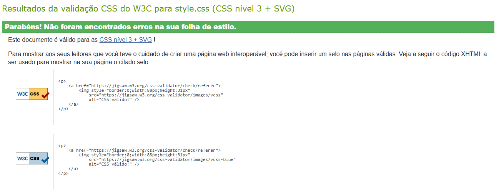
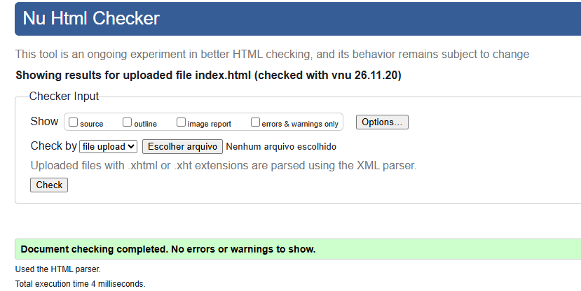
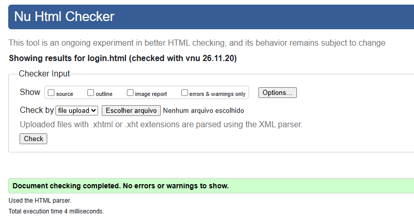
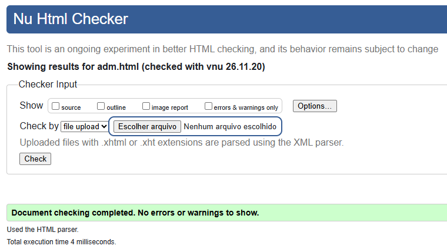

# 🚀 TechDelas - Mulheres na Tecnologia

> Aplicação web desenvolvida para incentivar a participação, inclusão e valorização das mulheres no ecossistema de tecnologia,
> oferecendo acesso a conteúdos educativos e cursos gratuitos de programação.

---

## 📌 Sumário
- [Sobre o Projeto](#-sobre-o-projeto)
- [Funcionalidades](#funcionalidades)
- [Estrutura do Projeto](#-estrutura-do-projeto)
- [Validação do Projeto](#-validação-do-projeto)
- [Tecnologias Utilizadas](#tecnologias-utilizadas)
- [Como Visualizar o Projeto](#-como-visualizar-o-projeto)
- [Integrantes da Equipe](#-integrantes-da-equipe)

---

## 💻 Sobre o Projeto

O **TechDelas** é um projeto web acadêmico desenvolvido para a disciplina de **Programação Web Front-End** da
**UTFPR - Câmpus Cornélio Procópio**. 

O objetivo principal da plataforma é combater a desigualdade de gênero na área de Tecnologia da Informação,
estando diretamente alinhado ao **Objetivo de Desenvolvimento Sustentável número 5 (ODS 5)** da ONU. Nesta etapa (Projeto 2), a aplicação conta com funcionalidades dinâmicas em **JavaScript puro**, manipulação da **DOM** e armazenamento local via **Local Storage**.

---

## ⚙️ Funcionalidades

- **Página Principal (index.html):** Apresentação da missão, destaque para cursos de HTML, CSS e JavaScript, informações sobre a ODS 5, item de menu **Adm** e acesso aos currículos virtuais no rodapé.
- **Página de Login e Cadastro (login.html):** Formulário completo com validação de campos obrigatórios (nome, e-mail, senha, telefone e área de interesse).
- **Painel Administrativo (adm.html):** Cadastro de novos usuários (nome e e-mail) em uma lista não ordenada salvos no **Local Storage** em chave única com objeto JSON (incluindo data de envio), com opções de limpar campos, excluir item específico, excluir todos os itens (com confirmação) e pesquisar registros.
- **Currículos Integrados (cvj/ e cvl/):** Páginas de currículo individuais e responsivas de cada membro da equipe.

---

## 📂 Estrutura do Projeto

O repositório está organizado da seguinte forma:

```text
📦 TechDelas
 ┣ 📂 css
 ┃ ┗ 📜 style.css
 ┣ 📂 imagens
 ┃ ┣ 📂 validacao
 ┃ ┃ ┣ 📜 css.png
 ┃ ┃ ┣ 📜 index.png
 ┃ ┃ ┣ 📜 adm.png
 ┃ ┃ ┗ 📜 login.png
 ┃ ┣ 📜 banner.png
 ┃ ┣ 📜 icon.png
 ┃ ┗ 📜 ... (demais imagens do projeto)
 ┣ 📂 cvj
 ┃ ┣ 📂 css
 ┃ ┃ ┗ 📜 style.css
 ┃ ┣ 📂 imagens
 ┃ ┃ ┗ 📜 ...
 ┃ ┗ 📜 cvj.html
 ┣ 📂 cvl
 ┃ ┣ 📂 css
 ┃ ┃ ┗ 📜 style.css
 ┃ ┣ 📂 figs
 ┃ ┃ ┗ 📜 ...
 ┃ ┗ 📜 cvl.html
 ┣ 📜 adm.html
 ┣ 📜 index.html
 ┣ 📜 login.html
 ┗ 📜 README.md
```

---

## 💻 Validação do Projeto

- Comprovante de validação CSS:


- Comprovante de validação index:


- Comprovante de validação login:


- Comprovante de validação adm:


---

## 🛠️ Tecnologias Utilizadas

- **HTML5:** Estruturação semântica de conteúdo.
- **CSS3:** Estilização unificada com variáveis customizadas, Flexbox e layout responsivo.
- **JavaScript (ES6+):** Manipulação dinâmica da DOM, eventos, pesquisa/filtragem e operações de cadastro e exclusão.
- **Web Storage (Local Storage):** Persistência de dados no navegador em chave única utilizando objetos JSON.
- **Google Fonts:** Tipografia externa (`Poppins` e `Roboto`).
- **Google Material Icons:** Ícones interativos para melhoria da interface.
- **GitHub Pages:** Alojamento e publicação do projeto na web.

---

## 🔗 Como Visualizar o Projeto

Você pode acessar o projeto de duas formas:
1. **Online (GitHub Pages):** [Acesse o site publicado aqui](https://liviacs07.github.io/Projeto2-TechDelas/)
2. **Localmente:** Baixe os arquivos do repositório e abra o arquivo `index.html` em qualquer navegador web.

---

## 👥 Integrantes da Equipe

Projeto desenvolvido pelas alunas do curso de Engenharia de Software da UTFPR - Câmpus Cornélio Procópio:

- **Júlia Marques da Silva de Oliveira** — [Ver Currículo Online](https://liviacs07.github.io/Projeto2-TechDelas/cvj/cvj.html)
- **Lívia Cardoso dos Santos** — [Ver Currículo Online](https://liviacs07.github.io/Projeto2-TechDelas/cvl/cvl.html)
